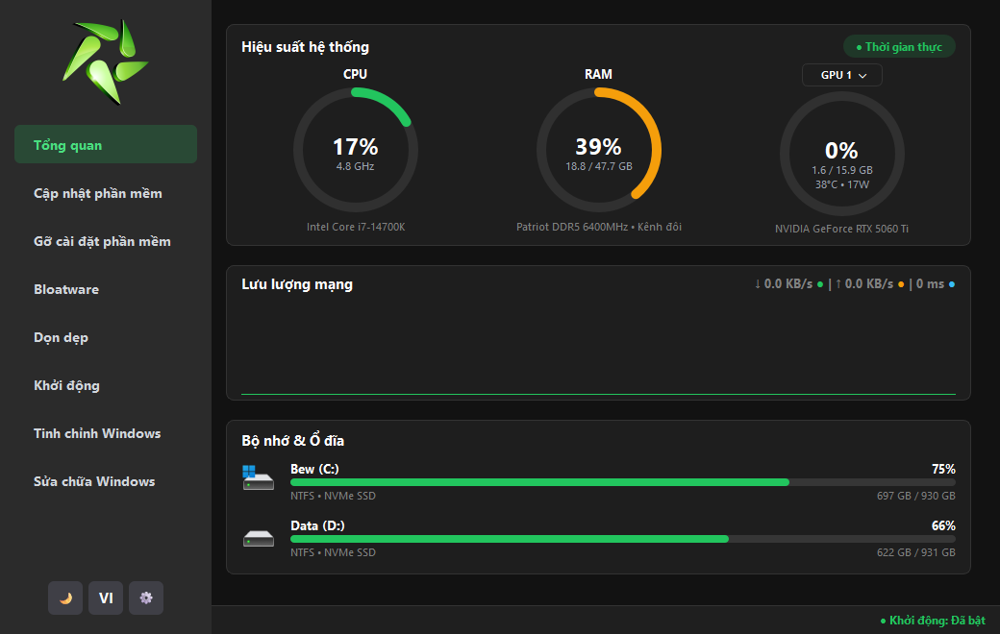
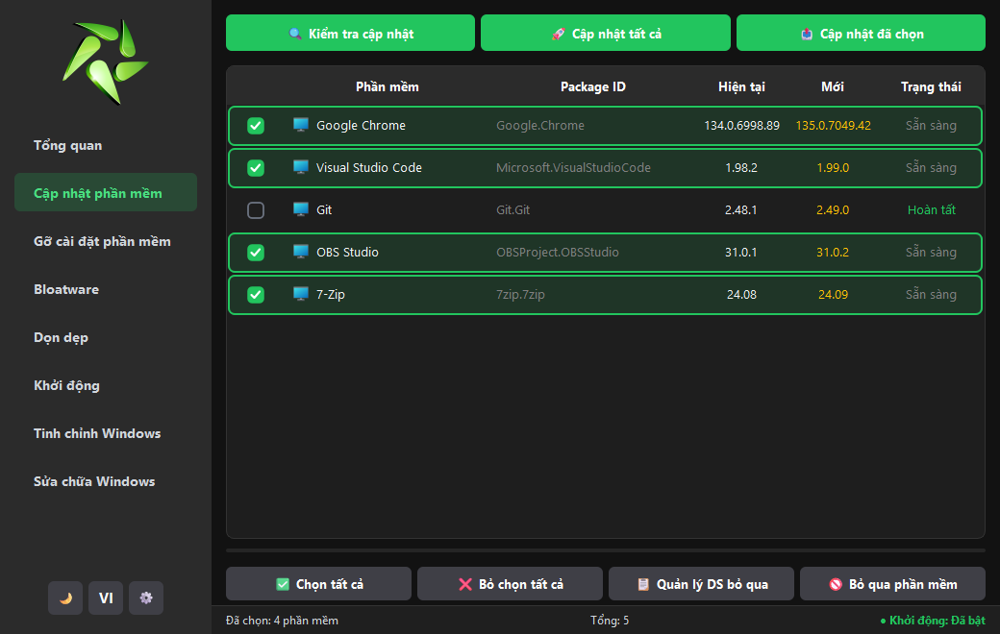
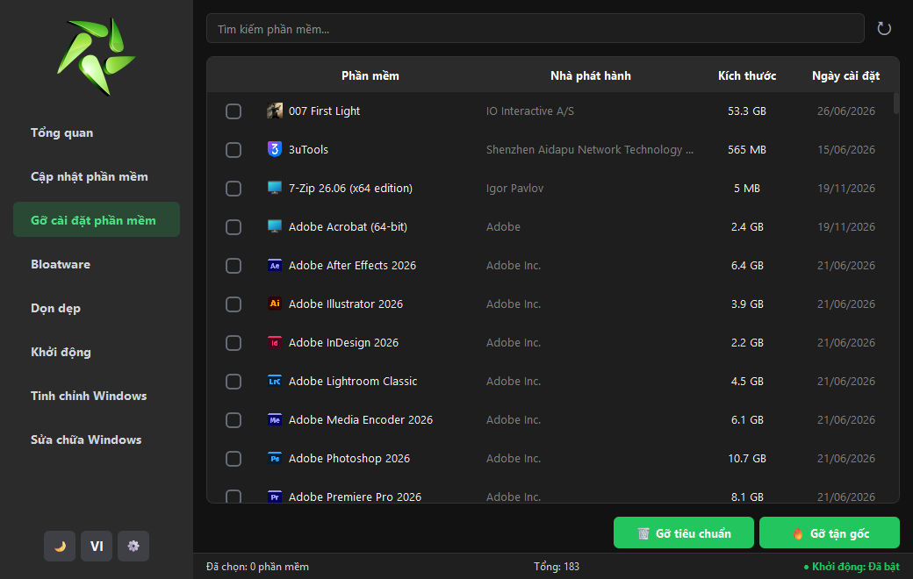
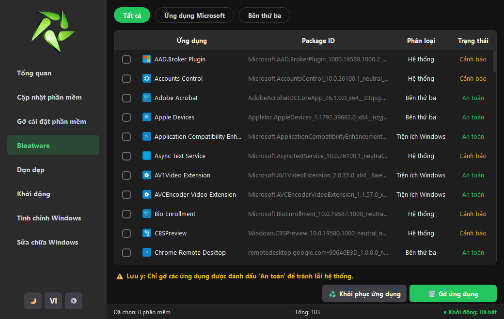
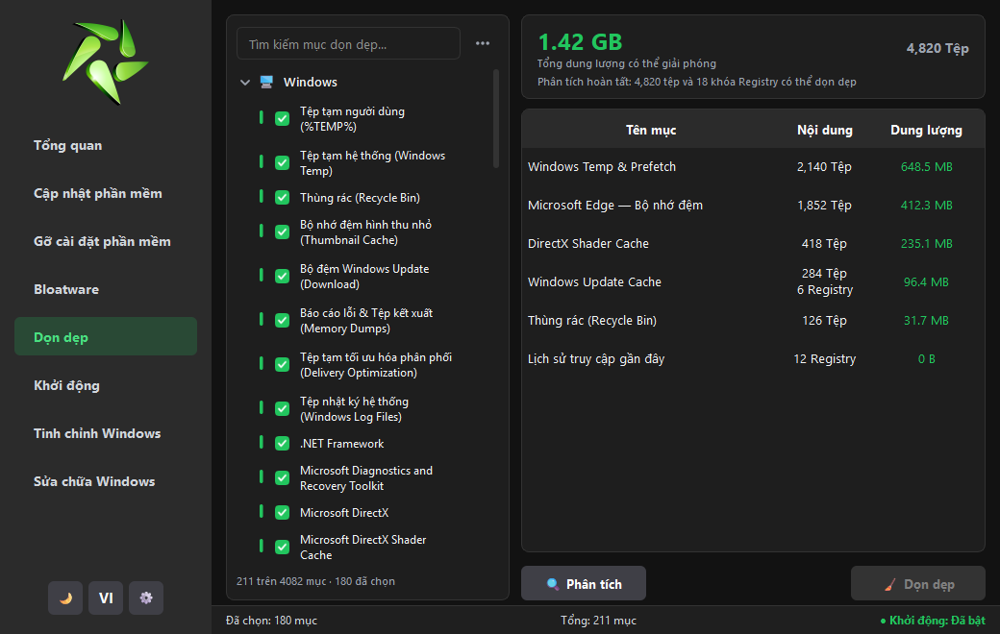
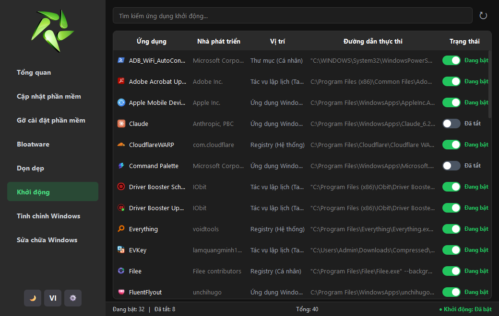
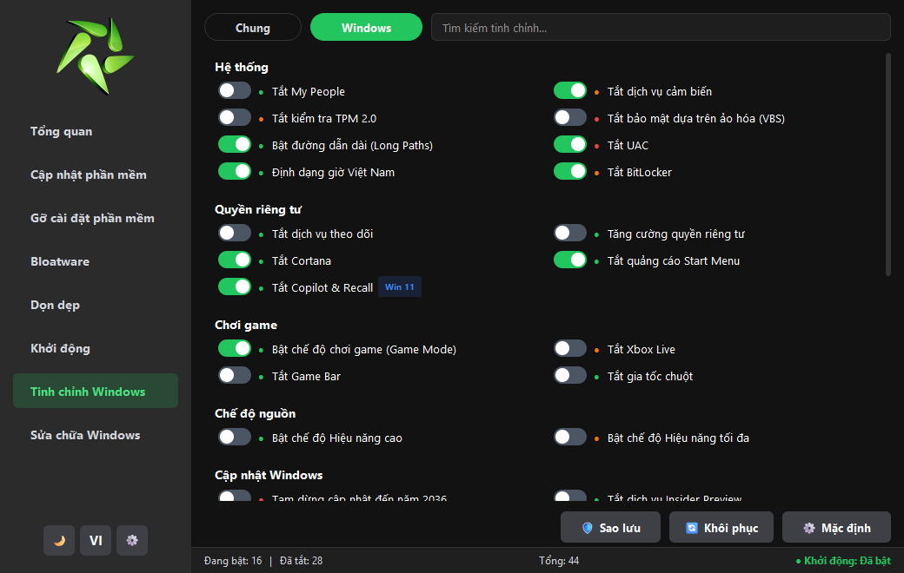
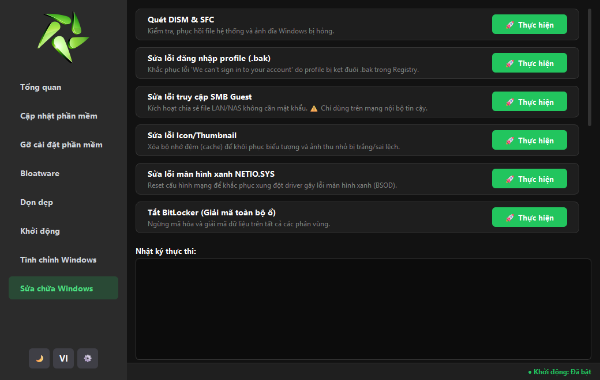
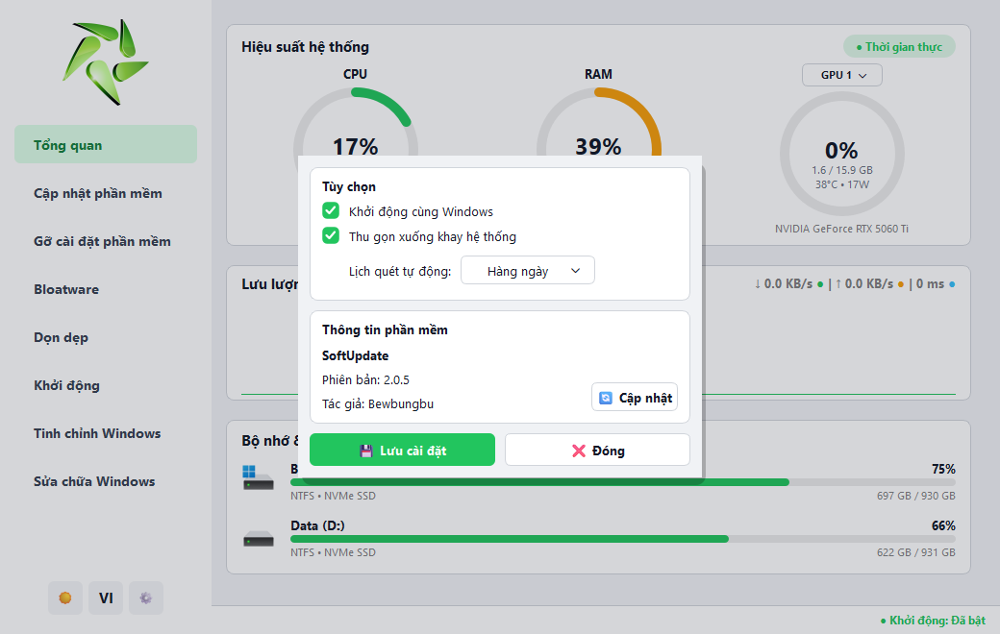

  
  <h1>SoftUpdate</h1>
  

    <strong>Bộ công cụ quản lý, cập nhật phần mềm (Winget GUI), dọn dẹp, tinh chỉnh và sửa chữa toàn diện cho Windows 10 / 11</strong>
  

  

    
    
    
    
  

  

    <a href="#giới-thiệu">Giới thiệu</a> •
    <a href="#tính-năng-chính">Tính năng chính</a> •
    <a href="#điểm-mới-ở-v205">Điểm mới v2.0.5</a> •
    <a href="#cài-đặt--sử-dụng">Cài đặt & Sử dụng</a> •
    <a href="#tùy-chỉnh--cấu-hình">Cấu hình</a> •
    <a href="#tác-giả">Tác giả</a>
  

---

## Giới thiệu

**SoftUpdate** là ứng dụng tiện ích hệ thống tất-cả-trong-một (All-in-One) dành cho **Windows 10 & Windows 11**, được thiết kế gọn nhẹ, hiện đại với giao diện Tối/Sáng và hỗ trợ song ngữ **Tiếng Việt / Tiếng Anh**.

Thay vì phải cài nhiều phần mềm rời rạc hoặc gõ lệnh thủ công, SoftUpdate tích hợp trọn bộ **8 phân hệ cốt lõi** trong một cửa sổ duy nhất:

1. **Tổng quan (Dashboard)** — Theo dõi phần cứng & hiệu suất thời gian thực.
2. **Cập nhật phần mềm** — Quét & nâng cấp hàng loạt ứng dụng qua lõi `winget` của Microsoft.
3. **Gỡ cài đặt phần mềm** — Gỡ tiêu chuẩn & Gỡ tận gốc sạch tệp rác, Registry, dịch vụ thừa.
4. **Bloatware** — Gỡ bỏ & khôi phục ứng dụng UWP / Microsoft Store cài sẵn.
5. **Dọn dẹp hệ thống** — Bộ máy chuẩn `Winapp2.ini` phân tích chi tiết tệp & Registry trước khi xóa.
6. **Khởi động (Startup)** — Kiểm soát toàn bộ ứng dụng chạy cùng Windows (Registry, Startup, Task Scheduler).
7. **Tinh chỉnh Windows** — 64 tinh chỉnh tối ưu hiệu năng, bảo mật, chơi game & giao diện Windows 10/11.
8. **Sửa chữa Windows** — 12 công cụ chẩn đoán & khắc phục lỗi Windows một chạm.

---

## Điểm mới ở v2.0.5

- **Cập nhật phần mềm thông minh hơn:**
  - Tự động **phát hiện ứng dụng đang mở** trước khi cập nhật với hộp thoại 3 lựa chọn (*Đóng & Cập nhật* / *Vẫn cập nhật* / *Hủy*), ưu tiên đóng êm để bảo toàn dữ liệu.
  - **Hậu kiểm bộ cài chạy ngầm** (giữ trạng thái đang cập nhật & khóa nút cho đến khi bộ cài ngầm hoàn tất, kèm van an toàn chống treo).
  - **Timeout thông minh** (Idle 5 phút / Trần 20 phút cho các bộ cài nặng cỡ GB) và giải mã mã lỗi Winget kèm tooltip giải thích trực tiếp.
- **Tinh chỉnh Windows chuẩn xác & an toàn hơn:**
  - **Tắt BitLocker** ở tab Tinh chỉnh nay áp dụng cho **toàn bộ ổ đĩa nội bộ** (`C:`, `D:`, `E:`...) và tự động loại trừ USB / ổ cứng rời.
  - Tự động nhận diện dịch vụ không tồn tại trên Windows 11 (như `Fax`, `HomeGroup`, `Media Player Legacy`, `NVIDIA Telemetry` cũ) để khóa công tắc và gắn nhãn `Không có sẵn`.
- **Hoàn thiện giao diện & trải nghiệm:**
  - Menu khay hệ thống (System Tray) bo góc trong suốt đồng bộ Dark/Light Mode.
  - Căn giữa quang học chuẩn từng pixel cho các nút điều khiển thanh bên (`VI` / `EN`, Theme, Cài đặt).
  - Tối ưu vòng đời worker, bảo toàn trạng thái phóng to khi thu gọn khay và cơ chế cập nhật OTA xác thực **SHA-256**.

---

## Tính năng chính

### 1. Tổng quan hệ thống (Dashboard)
- Theo dõi trực quan **CPU, RAM, GPU** (hỗ trợ chuyển đổi nhiều GPU, hiển thị nhiệt độ, công suất, VRAM), **Lưu lượng mạng** (Download / Upload / Ping) và **Ổ đĩa nội bộ** theo thời gian thực.
- Tự động tạm dừng luồng giám sát và giải phóng RAM khi ẩn xuống khay hệ thống hoặc chuyển sang tab khác.

---

### 2. Cập nhật phần mềm (Winget GUI)
- Quét nhanh và nâng cấp hàng loạt (**Cập nhật tất cả** / **Cập nhật đã chọn**) bằng lõi `winget` chính chủ của Microsoft.
- **Bảo vệ ứng dụng đang chạy:** Quét tiến trình đang mở (hỗ trợ cả ứng dụng Win32 lẫn gói MSIX `WindowsApps`) và cho phép chọn *Đóng & Cập nhật* (đóng êm trước, ép đóng khay sau), *Vẫn cập nhật* hoặc *Hủy*.
- **Hậu kiểm cài ngầm & Timeout thông minh:** Không cắt nhầm bộ cài dung lượng lớn đang tải, chờ bộ cài tách tiến trình hoàn tất và hiển thị lý do chi tiết qua tooltip nếu xảy ra lỗi.
- Hỗ trợ **Danh sách bỏ qua (Ignore List)** và **Lịch quét tự động** định kỳ (Hàng ngày / Hàng tuần / Hàng tháng).

---

### 3. Gỡ cài đặt phần mềm (Uninstaller)
- Quét đầy đủ phần mềm cài đặt trên hệ thống kèm biểu tượng gốc, nhà phát hành, dung lượng ước tính và ngày cài đặt; tìm kiếm nhanh hỗ trợ tiếng Việt không dấu.
- **Gỡ tiêu chuẩn** hoặc **Gỡ tận gốc (Force Uninstall):** Tự động dò và liệt kê chi tiết tệp/thư mục tàn dư, khóa Registry, dịch vụ nền và tác vụ định kỳ để người dùng kiểm tra trước khi xóa sạch.

---

### 4. Quản lý Bloatware (WinApps)
- Liệt kê các ứng dụng UWP / Microsoft Store cài sẵn với bộ lọc nhanh (**Tất cả** / **Ứng dụng Microsoft** / **Bên thứ ba**).
- Gắn nhãn phân loại và mức độ an toàn (**An toàn** / **Cảnh báo**) giúp tránh gỡ nhầm thành phần hệ thống lõi.
- Hỗ trợ **Khôi phục ứng dụng** mặc định đã gỡ khi cần thiết.

---

### 5. Dọn dẹp hệ thống (System Cleaner)
- Động cơ quét tương thích chuẩn **`Winapp2.ini`** với hàng trăm quy tắc dọn dẹp theo danh mục (Windows, Trình duyệt, Ứng dụng, Trò chơi, Đa phương tiện, Tiện ích...).
- Tìm kiếm nhanh danh mục, thao tác chọn mặc định an toàn, phân tích dung lượng có thể giải phóng và **xem chi tiết từng tệp / khóa Registry** trước khi quyết định xóa.

---

### 6. Quản lý Khởi động (Startup Manager)
- Tổng hợp toàn bộ mục khởi động cùng Windows từ **Registry (Hệ thống & Cá nhân)**, **Thư mục Startup**, **Ứng dụng Windows (MSIX)** và **Tác vụ lập lịch (Task Scheduler)**.
- Bật/tắt tức thì bằng công tắc gạt, xem rõ nhà phát triển, vị trí lưu và đường dẫn thực thi đầy đủ.

---

### 7. Tinh chỉnh Windows (64 tinh chỉnh)
- Chia làm 2 phân khu **Chung (20 mục)** và **Windows (44 mục, gồm 8 mục riêng Windows 11)** trên 10 nhóm: *Hệ thống, Ổ đĩa, Quyền riêng tư, Ứng dụng, Chơi game, Chế độ nguồn, Cập nhật Windows, Thanh tác vụ, Mở rộng, Tinh chỉnh nâng cao*.
- Phân cấp 3 mức rủi ro trực quan bằng chấm màu (🟢 **An toàn** · 🟠 **Tùy nhu cầu** · 🔴 **Cẩn trọng**) kèm tooltip mô tả chi tiết cho từng mục.
- Tích hợp sẵn **Sao lưu (Tạo điểm khôi phục hệ thống)**, **Khôi phục (System Restore)** và **Mặc định (Đặt lại chuẩn gốc Windows 10/11)**.

---

### 8. Sửa chữa Windows (12 công cụ một chạm)
Tích hợp 12 tác vụ xử lý các sự cố Windows thường gặp kèm khung **Nhật ký thực thi** trực tiếp:

| # | Công cụ sửa chữa | Công dụng chính |
| :-: | :--- | :--- |
| 1 | **Quét DISM & SFC** | Kiểm tra và phục hồi tệp hệ thống & ảnh đĩa Windows bị hỏng |
| 2 | **Sửa lỗi đăng nhập profile (`.bak`)** | Khắc phục lỗi *We can't sign in to your account* do profile bị kẹt `.bak` |
| 3 | **Sửa lỗi truy cập SMB Guest** | Kích hoạt chia sẻ file LAN/NAS không cần mật khẩu *(dùng trên mạng nội bộ tin cậy)* |
| 4 | **Sửa lỗi Icon/Thumbnail** | Xóa bộ nhớ đệm icon & ảnh thu nhỏ bị trắng hoặc hiển thị sai |
| 5 | **Sửa lỗi màn hình xanh `NETIO.SYS`** | Đặt lại cấu hình mạng khắc phục xung đột driver gây BSOD |
| 6 | **Tắt BitLocker (Giải mã toàn bộ ổ)** | Ngừng mã hóa và giải mã tất cả phân vùng nội bộ kèm tiến độ `%` |
| 7 | **Sửa lỗi xem trước File** | Kích hoạt lại Thumbnail & Preview Pane trong File Explorer |
| 8 | **Sửa lỗi Thanh tìm kiếm** | Khởi động lại `SearchUI` và xây dựng lại chỉ mục Windows Search |
| 9 | **Sửa lỗi Font chữ & ClearType** | Xóa Font Cache và khôi phục thiết lập làm mịn chữ ClearType chuẩn |
| 10 | **Sửa lỗi Windows Update** | Reset các dịch vụ & thư mục bộ nhớ đệm cập nhật Windows |
| 11 | **Sửa lỗi Mạng (IP/DNS/Winsock)** | Làm mới địa chỉ IP, xóa DNS Cache và khôi phục Winsock |
| 12 | **Sửa lỗi Windows Store** | Xóa cache Microsoft Store (`wsreset`) và đăng ký lại gói Store |

---

## Yêu cầu hệ thống

- **Hệ điều hành:** Windows 10 (64-bit) hoặc Windows 11 (64-bit).
- **Quyền thực thi:** Quyền Quản trị viên (**Administrator / UAC**) để thực hiện các tác vụ cập nhật, gỡ phần mềm, tinh chỉnh Registry/Dịch vụ và sửa chữa hệ thống.
- **Microsoft Winget (App Installer):** Cài sẵn trên Windows 11 và hầu hết bản Windows 10 hiện đại (cần cho tab *Cập nhật phần mềm*).

---

## Cài đặt & Sử dụng

### Cách 1: Cài đặt nhanh bằng bộ cài (Khuyên dùng)
1. Truy cập mục **[Releases](https://github.com/Bewbungbu/SoftUpdate/releases/latest)** và tải tệp **`SoftUpdate_Setup_v2.0.5.exe`**.
2. Chạy trình cài đặt và làm theo hướng dẫn trên màn hình.
3. Mở **SoftUpdate** từ Desktop hoặc Start Menu (xác nhận UAC khi được hỏi).

### Cách 2: Cập nhật tự động (OTA) từ phiên bản cũ
- Mở **Cài đặt** (biểu tượng bánh răng góc dưới bên trái) → bấm **Cập nhật** trong mục *Thông tin phần mềm*.
- SoftUpdate tự động kiểm tra bản phát hành mới nhất từ GitHub, tải bộ cài, **xác thực mã băm SHA-256** và khởi chạy nâng cấp an toàn.

---

## Tùy chỉnh & Cấu hình

Ở góc dưới thanh điều hướng bên trái có 3 nút điều khiển nhanh:
- **Chuyển giao diện (`🌙` / `☀️` / `💻`):** Chuyển đổi tức thì giữa **Tối (Dark)**, **Sáng (Light)** và **Theo hệ thống (System)**.
- **Đổi ngôn ngữ (`VI` / `EN`):** Chuyển đổi song ngữ **Tiếng Việt ↔ Tiếng Anh** toàn bộ ứng dụng không cần khởi động lại.
- **Cài đặt (`⚙`):**
  - Bật/tắt **Khởi động cùng Windows** (qua Task Scheduler, chạy ngầm không bật UAC lặp lại).
  - Bật/tắt **Thu gọn xuống khay hệ thống (System Tray)**.
  - Thiết lập **Lịch quét tự động** (*Hàng ngày* / *Hàng tuần* / *Hàng tháng* / *Tắt*).
  - Kiểm tra **Cập nhật ứng dụng (OTA)** trực tiếp từ GitHub.

> [!TIP]
> Nhấn tổ hợp phím **`Ctrl + Shift + L`** bất cứ lúc nào để mở cửa sổ **Nhật ký hoạt động (Logs)** phục vụ kiểm tra chi tiết quá trình cập nhật, dọn dẹp hoặc sửa lỗi.

---

## Tác giả

Phát triển và duy trì bởi **[Bewbungbu](https://www.facebook.com/dangpham0695)**.

- **GitHub:** [https://github.com/Bewbungbu/SoftUpdate](https://github.com/Bewbungbu/SoftUpdate)
- **Facebook:** [https://www.facebook.com/dangpham0695](https://www.facebook.com/dangpham0695)
- **Báo lỗi & Góp ý tính năng:** [GitHub Issues](https://github.com/Bewbungbu/SoftUpdate/issues)

---

  Nếu thấy <strong>SoftUpdate</strong> hữu ích, hãy tặng dự án một ⭐ <strong>Star</strong> trên GitHub nhé!

